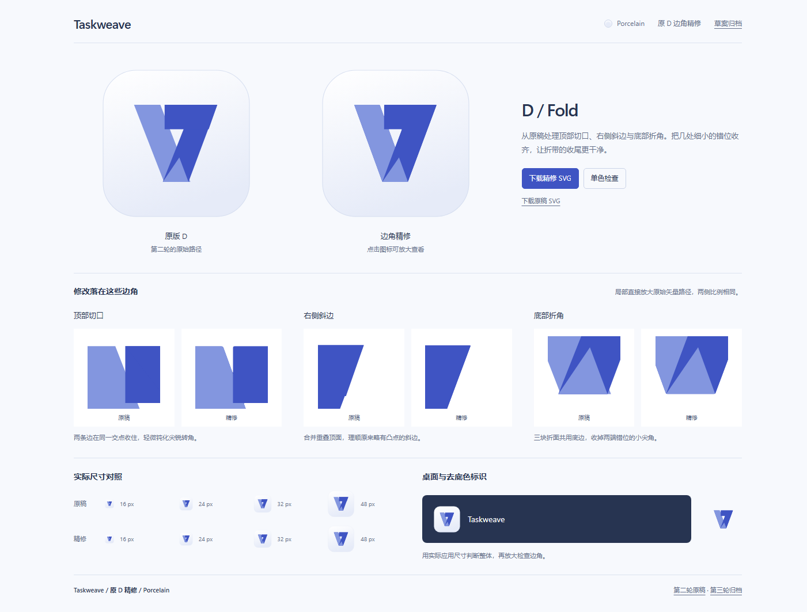

# TaskWeave / D / Porcelain

最终确认 **TaskWeave + D 边角精修 + Porcelain**，用于 0.4.0。精修重点是原稿的边角、接缝与收口；T 是自然浮现的加分项。

- [原稿与精修对照](round-4.html)：同尺寸并排、三处边角放大、16–48px、单色与深色背景检查，支持 SVG 下载。
- [完整对比图](candidates-v4.png)，`candidates.png` 是最新图的别名。
- [精修 SVG](round-4/icons/taskweave-d-refined-porcelain.svg) / [去底色标识](round-4/icons/taskweave-d-refined-mark.svg)
- [原 D 的 Porcelain SVG](round-4/icons/taskweave-d-original-porcelain.svg)

## 具体调整

1. 顶部切口按真实边线交点收齐，并做极小的光学圆角。
2. 合并重复顶面，处理右侧斜边在折面交接处的小凸点。
3. 前后带宽统一，三块折面共用底部端点，清理底角错位。

[设计记录](round-4/design.md)包含几何依据。`round-4/marks.js` 是预览与下载的同一图形来源；运行 `node docs/branding/round-4/export-svg.mjs` 可重新生成 SVG。

## 归档

- [第三轮](round-3.html) / [对比图](candidates-v3.png)：用户认为 T 的设计过于刻意，回到原版 D 精修边角。
- [第二轮](round-2.html) / [对比图](candidates-v2.png)：六个英文名称、A–F 图形与四种配色；用户倾向 TaskWeave、D 和 Porcelain。
- [第一轮](round-1.html) / [对比图](round-1.png)

正式母版为 [`assets/branding/taskweave.svg`](../../assets/branding/taskweave.svg)，运行 `pnpm icons` 生成应用图标资源。

本机预览：<http://127.0.0.1:8840/round-4.html>。`candidates.html` 自动打开最终对照页。
